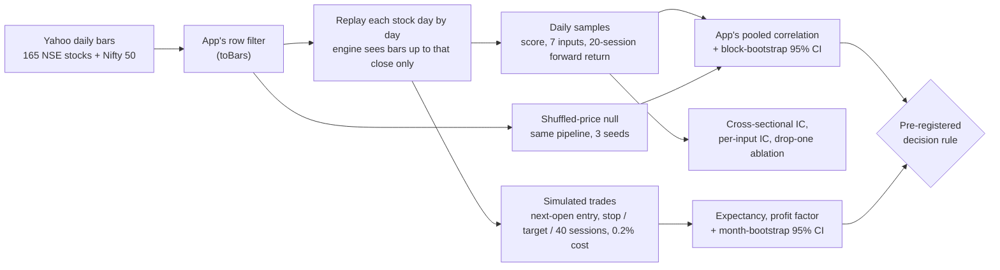

# Does the mid-term score predict anything? A pre-registered test

**Engine:** the weeks-to-months (mid-term) score in `src/lib/midterm.ts`, unchanged. **Measured:** 22 November 2026. **Plan:** [fixed in advance](mid-engine-preregistration.md), committed before the held-out window was run. **Raw results:** [`results/mid-recent.json`](results/mid-recent.json), [`results/mid-2019-2022.json`](results/mid-2019-2022.json).

## Answer in five lines

1. **No demonstrated edge.** The pre-registered test needed the score to beat zero, with 95% confidence, in two separate periods. It did so in neither.
2. **The earlier "inverted" reading was mostly the measuring method.** On shuffled prices, where nothing can be predicted, the app's correlation measure already reads −0.124 and −0.066. The real readings were −0.199 and −0.049, so most of the negative value comes from the measure itself. What remains (−0.075 and +0.017) is small and points in opposite directions.
3. **The score does not rank stocks.** On any given day, high-scoring stocks did no better or worse than low-scoring ones in either period: the average daily rank correlation was −0.008 and +0.001.
4. **Trades lost money on average in one period and made money in the other.** The profitable period (2019–2022) was a strong bull market, in which shuffled prices also produced profitable trades. In both periods, buy-and-hold beat the strategy for the average stock.
5. **No single input carries signal.** None of the seven inputs has a daily rank correlation distinguishable from zero in either period.

## The decision, against the rule written in advance

The score would count as having an edge only if all four checks passed: in **both** periods, the correlation interval lies above zero with an estimate above 0.05, **and** the expectancy interval lies above zero with an estimate above 0.03R.

| Check | Oct 2024 – Oct 2026 (recent) | 2019–2022 (held out) |
| --- | --- | --- |
| Correlation above zero? | **No:** −0.199, 95% CI −0.291 to −0.135 | **No:** −0.049, 95% CI −0.141 to +0.025 |
| Net expectancy above zero? | **No:** −0.136R, 95% CI −0.299 to +0.020 | Yes: +0.119R, 95% CI +0.007 to +0.227 |
| **Hypothesis supported?** | **No** | **No** |

Result: **no demonstrated edge**, the same conclusion as the earlier record. The app shows this in the verdict card, the weeks-to-months brief and Strategy evidence (`src/lib/validation.ts`).

## How the study works



1. **Same code as the app.** The script loads `src/lib/backtest.ts` and `src/lib/midterm.ts` directly and runs the app's own replay. It stops with an error unless its samples reproduce the app's pooled correlation to nine decimal places.
2. **No look-ahead.** On each day the engine sees only bars up to that day's close. Entries fill at the next open.
3. **Uncertainty.** Neighbouring days share 19 of their 20 forward days, and stocks move together, so the samples are far from independent. A naive standard error would be much too small. The block bootstrap resamples 40-session blocks of whole trading days, which keeps both effects.
4. **A baseline for "no skill".** Each stock's days are shuffled in time, so every daily move is kept but their order is random. The same pipeline then shows what the statistics look like when there is nothing to predict.
5. **Decided in advance.** The hypothesis, windows, statistics and decision rule were committed before the held-out window was run: [analysis plan](mid-engine-preregistration.md).

## Reproduce it

```bash
npm test                                                     # 60 tests, incl. the statistics
node scripts/research/mid-study.mjs --window recent --null 3
node scripts/research/mid-study.mjs --window 2019-2022 --null 3
```

The first run of each window downloads bars to `.data/research/` (not committed); later runs reuse them, so the figures are reproducible. `--refresh` downloads again. Each run takes a few minutes and writes `docs/research/results/mid-<window>.json`.

## Results

### Headline figures

| | Oct 2024 – Oct 2026 | 2019–2022 |
| --- | ---: | ---: |
| Decision dates | 2024-10-01 to 2026-10-22 (510) | 2019-01-01 to 2022-12-02 (970) |
| Stocks studied | 165 of 165 | 163 of 165 |
| Daily observations (overlapping) | 83,652 | 152,859 |
| Pooled correlation (app's measure) | −0.199 [−0.291, −0.135] | −0.049 [−0.141, +0.025] |
| Same measure on shuffled prices (3 seeds) | −0.113, −0.119, −0.141 (mean −0.124) | −0.067, −0.075, −0.056 (mean −0.066) |
| Real minus shuffled | −0.075 | +0.017 |
| Mean daily rank correlation (IC) | −0.008 [−0.065, +0.050] | +0.001 [−0.043, +0.045] |
| Simulated trades | 2,046 | 4,231 |
| Net expectancy per trade | −0.136R [−0.299, +0.020] | +0.119R [+0.007, +0.227] |
| Profit factor | 0.79 [0.57, 1.09] | 1.37 [1.05, 1.77] |
| Win rate | 41.4% [33.9, 48.9] | 53.3% [47.7, 58.6] |
| Strategy return per stock (average, compounded) | −10.7% | +51.1% |
| Buy-and-hold per stock (average, same windows) | +1.1% | +121.4% |
| With the Nifty-above-50-EMA filter | 1,682 trades, −0.159R, PF 0.75 | 3,851 trades, +0.126R, PF 1.40 |

Square brackets are 95% intervals. Six-figure counts use international grouping here; the app shows Indian grouping.

### Why the shuffled-price baseline matters

The app's correlation is calculated *within* each stock's own history and then averaged. Within one stock over a fixed period, the start and end prices are fixed. A trend score is high after a rise, and if the price is going to end where it ends anyway, a strong earlier rise leaves less room for a later one. That pulls the correlation below zero even when prices are completely unpredictable.

Shuffling each stock's days in time measures how strong this effect is. It keeps every daily move, gap and candle shape and destroys any order the moves were in. On shuffled data the measure read −0.12 in the recent period and −0.07 in 2019–2022, so most of the negative readings are produced by the measure itself. The longer 2019–2022 period shows a weaker effect, as expected, because longer histories constrain each stock's path less.

Measured against this baseline, the real data did slightly worse than chance in the recent period (−0.075) and slightly better in 2019–2022 (+0.017). Those differences point in opposite directions and are small next to the intervals. The earlier record's conclusion, "higher scores were followed by lower returns", was literally true of the sample. It is not evidence that the score predicts lower returns.

The daily rank correlation (IC) avoids the problem entirely. It compares stocks with each other on the same day instead of a stock with its own history, and it was close to zero in both periods.

### Score buckets (average 20-session forward price change)

| Score bucket | Recent: n | Recent: avg | 2019–22: n | 2019–22: avg |
| --- | ---: | ---: | ---: | ---: |
| below 40 | 40,028 | +0.66% | 56,720 | +1.85% |
| 40–50 | 3,550 | +0.07% | 6,222 | +1.87% |
| 50–58 | 4,370 | −0.27% | 6,263 | +1.43% |
| 58–72 (buy zone) | 11,675 | −0.34% | 21,351 | +1.79% |
| 72+ | 24,029 | −0.33% | 62,303 | +1.90% |
| **72+ minus below 40** | | **−0.99% [−2.48, +0.59]** | | **+0.05% [−1.94, +2.28]** |

In 2019–2022 the buckets are flat: every bucket gained about 1.4–1.9%, because almost everything rose. In the recent period the low bucket did better, but the interval for the gap includes zero.

### Trades

Trades lost 0.136R each in the recent period and made 0.119R in 2019–2022. Only the 2019–2022 interval excludes zero. The equal-weighted average stock more than doubled over those years (buy-and-hold +121% per stock), and a long-only rule that buys after strength made money in that market. The shuffled-price runs also averaged +0.07R to +0.09R per trade there.

The shuffled trades are **not** a like-for-like baseline for trade returns. Shuffling spreads each stock's drift over its whole download, including the warm-up years, so a period that really fell (the recent one) receives some of the earlier gains. The plan uses the shuffle only to interpret correlations, and it is reported here only for completeness.

The Nifty-uptrend filter changed little in either period.

### The seven inputs

IC is each input's mean daily rank correlation with the 20-session return across stocks. Drop-one Δ is the pooled correlation with all seven inputs minus the pooled correlation with this input removed (weights renormalised). A positive Δ means the input pushed the correlation up.

| Input (weight) | Recent IC | 2019–22 IC | Recent drop-one Δ | 2019–22 drop-one Δ |
| --- | --- | --- | --- | --- |
| Price vs 50 & 200-day SMA (20) | −0.006 [−0.052, +0.041] | −0.005 [−0.042, +0.034] | +0.011 [+0.004, +0.016] | +0.002 [−0.004, +0.008] |
| 50/200 SMA structure (16) | +0.015 [−0.037, +0.064] | +0.024 [−0.018, +0.067] | −0.014 [−0.025, +0.003] | −0.002 [−0.012, +0.011] |
| Weekly trend (16) | −0.008 [−0.058, +0.044] | −0.003 [−0.042, +0.037] | +0.007 [+0.000, +0.012] | +0.000 [−0.004, +0.004] |
| Trend strength, ADX (12) | −0.027 [−0.068, +0.018] | −0.020 [−0.048, +0.010] | −0.001 [−0.008, +0.004] | −0.001 [−0.006, +0.004] |
| 3 & 6-month momentum (14) | −0.013 [−0.066, +0.041] | +0.005 [−0.032, +0.042] | −0.004 [−0.011, +0.002] | −0.003 [−0.009, +0.004] |
| RSI 14 (8) | −0.026 [−0.066, +0.017] | −0.019 [−0.046, +0.008] | +0.000 [−0.004, +0.003] | +0.001 [−0.002, +0.003] |
| Position in 52-week range (14) | +0.014 [−0.043, +0.071] | +0.010 [−0.039, +0.062] | −0.007 [−0.012, −0.002] | −0.000 [−0.004, +0.003] |

Every IC interval includes zero in both periods. Three drop-one intervals exclude zero in the recent period: price vs SMA, weekly trend, and 52-week position. **None of them repeats in 2019–2022.** This is the multiple-testing trap the plan warned about: with 28 intervals, a few will exclude zero by chance. The inputs most often cited as momentum evidence (3 & 6-month momentum, 52-week position) show no measurable effect on their own here. Nothing in the engine was changed because of this table.

### Robustness checks

| Check | Recent | 2019–2022 |
| --- | --- | --- |
| Nifty above its 50-day EMA | −0.191 [−0.310, −0.101], 40,342 obs. | −0.043 [−0.124, +0.017], 105,693 obs. |
| Nifty below its 50-day EMA | −0.216 [−0.331, −0.142], 43,153 obs. | −0.100 [−0.207, −0.017], 46,703 obs. |
| Every 20th date only (20 offsets, no overlap) | mean −0.194, range −0.248 to −0.147 | mean −0.047, range −0.079 to −0.028 |

The score did not work in either market regime, and using only non-overlapping dates gives the same picture, so the overlap of forward windows is not distorting the averages.

## Limits measured, not just stated

### Coverage

- **Recent:** all 165 stocks studied. One (TMCV) listed during the download period, on 2025-11-12, and enters the study only once it has 240 sessions.
- **2019–2022:** 163 of 165 studied. TMCV and IREDA listed after 2022 and have no data in the window. 17 more listed during the 2017–2022 download, for example IRFC (January 2021), Zomato/Eternal (July 2021) and Nykaa (November 2021). Each enters once it has enough history.

### Survivorship bias

The universe is today's list. Stocks that collapsed, were delisted or dropped out of the liquid set before 2026 are missing, so the study sees only the survivors.

| | Recent | 2019–2022 |
| --- | ---: | ---: |
| Stocks present at both ends | 164 | 156 |
| Equal-weighted stock return | −6.1% | +130.9% |
| Median stock return | −15.4% | +61.1% |
| Nifty 50 (price index), same dates | −12.1% | +72.1% |
| Share of stocks beating the Nifty 50 | 45.1% | 46.2% |

In both periods the equal-weighted average of today's stocks beat the index (by about 6 points recently and 59 points in 2019–2022), while the median stock lagged it and fewer than half of the stocks beat it. The average is pulled up by a few very large winners, and some of those are in today's list *because* they won: a stock that rose tenfold is far more likely to be large and liquid enough to be listed in 2026. The 59-point gap in 2019–2022 is therefore an upper bound on how much the study's universe flatters long-only results, not a measurement of the bias. It is also why buy-and-hold (+121% per stock) is a demanding comparison there. Correcting this properly needs a point-in-time list of the stocks that were liquid in 2019, including later delistings. The app's data source does not provide one.

### Data quality

| | Recent download | 2017–2022 download |
| --- | ---: | ---: |
| Rows from Yahoo | 121,610 | 209,241 |
| Dropped by the completeness filter | 8 | 0 |
| Zero-volume bars | 335 | 46 |
| One-day close moves beyond ±20% | 19 | 63 |
| Sessions where the Nifty traded but the stock has no bar | 1 | 0 |
| Duplicate dates | 0 | 0 |

- **Placeholder bars.** 321 of the 335 zero-volume bars in the recent download fall on two dates: 2025-03-18 (163 stocks) and 2026-01-15 (158 stocks). On those dates Yahoo returns a bar whose open, high, low and close all equal the previous close, with zero volume. 18 March 2025 was a normal NSE trading day, so these bars stand in for missing data; 15 January 2026 was not checked. They flatten range-based indicators (ATR, ADX) for a day and move that day's price change into the next bar. The app uses these bars as they are. Dropping zero-volume flat bars in `toBars` would be a small, testable fix.
- **Large moves.** Most are real events: the March 2020 COVID crash, Vodafone Idea's swings in 2019–2020 (20 events), and the public-sector bank recapitalisation rally of 25 October 2017 (PNB +46%). A few look like corporate actions left unadjusted in the price series, for example TMPV −40.2% on 2025-10-14 (around the Tata Motors demerger) and VEDL −64.9% on 2026-04-30. These were not verified against exchange records. An unadjusted demerger shows up as a crash that never happened, which matters for any backtest.
- **Prices are not dividend-adjusted,** so returns understate total returns by roughly the dividend yield. This affects levels, not the comparison between score buckets on the same day.

## What this study does and does not show

**It shows** that, under rules fixed in advance and with the app's own code, the mid-term score did not predict 20-session returns in either of two separate periods, either within each stock's history or across stocks on the same day. It also shows that the app's earlier "inverted" finding came mostly from the measuring method, which the app now explains beside the number.

**It does not show** that trend-following or momentum ideas fail in India in general. It tested one specific rule set with fixed weights, a 20-session horizon and a 40-session maximum hold, on today's universe of 165 stocks. Holding periods, cross-sectional ranking strategies, total-return data, a point-in-time universe including delisted stocks, and portfolio-level constraints were all outside its scope. A future change to the engine would need a new pre-registered test on data it has not seen. Neither window here can be reused as a holdout.

## Explaining it simply

- **What was tested?** Whether a higher weeks-to-months score was followed by a higher price four weeks later, and whether buying on the score's signal made money after costs.
- **How do you know you didn't cherry-pick?** The hypothesis, periods, statistics and pass mark were committed to git before the second period was run, and the commit history shows the order. One addition was made after the first result was seen (the shuffled-price baseline). It was written down as a dated amendment before the second run, and it did not change the pass mark.
- **Why the intervals?** Neighbouring days share 19 of their 20 forward days, and stocks move together. Treating 236,000 observations as independent would make the results look far more certain than they are. The block bootstrap resamples whole 40-day stretches of the calendar to allow for this.
- **What's the shuffled-price test?** It's a control experiment: it asks what the measure reads when there's nothing to find. If an unpredictable market already gives −0.12, then −0.20 is not strong evidence of anything.
- **So is the app useless?** No. It describes a stock's trend, risk and context transparently and dates every reading. This study shows that its score should be read as a description of the trend, not as a forecast, and the app now says that next to the score with the evidence.
