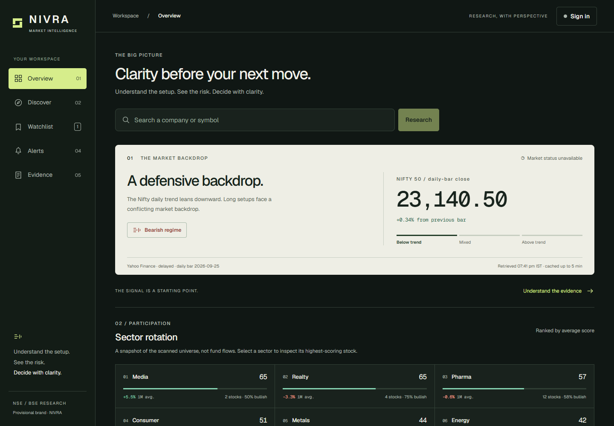
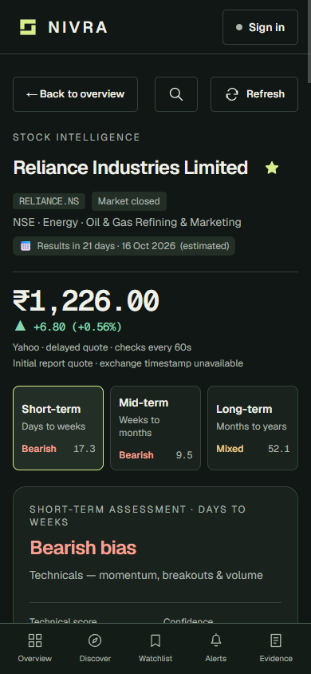

# NIVRA responsive design gallery

These are browser captures of the implemented production app, using actual Yahoo research responses. No illustrative market prices, scores or returns were seeded. The capture time and browser observations are recorded in [browser-verification.json](browser-verification.json); market-source timestamps remain separate from retrieval and screenshot times. This gallery is a design review artifact, not a statement that all verification checks passed.

| View | Desktop viewport | Mobile viewport |
| --- | --- | --- |
| Market overview | [View desktop](screenshots/desktop-overview-viewport.png) | [View mobile](screenshots/mobile-overview-viewport.png) |
| Discover | [View desktop](screenshots/desktop-discover-viewport.png) | [View mobile](screenshots/mobile-discover-viewport.png) |
| Stock intelligence report | [View desktop](screenshots/desktop-report-viewport.png) | [View mobile](screenshots/mobile-report-viewport.png) |
| Watchlist | [View desktop](screenshots/desktop-watchlist-viewport.png) | [View mobile](screenshots/mobile-watchlist-viewport.png) |
| Alerts | [View desktop](screenshots/desktop-alerts-viewport.png) | [View mobile](screenshots/mobile-alerts-viewport.png) |
| Strategy evidence | [View desktop](screenshots/desktop-evidence-viewport.png) | [View mobile](screenshots/mobile-evidence-viewport.png) |

## Market overview

## Mobile report

The [brand exploration board](../public/brand/explorations.png) shows the selected geometric mark, two alternatives, size variants and palette. [Brand usage and name screening](brand.md), [design system](design-system.md) and [repository audit](audit.md) provide the rationale and implementation constraints.
